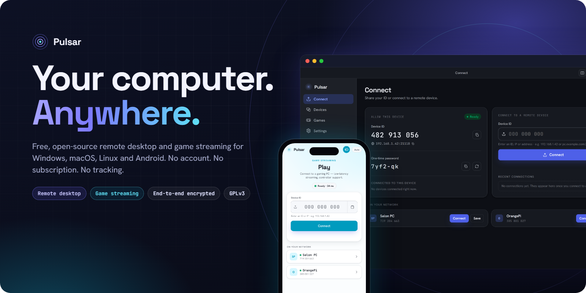
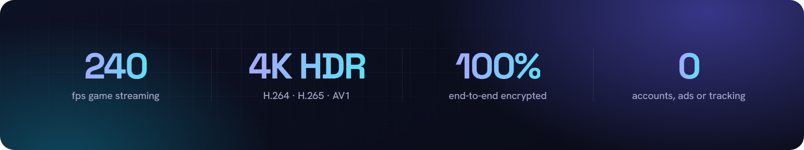
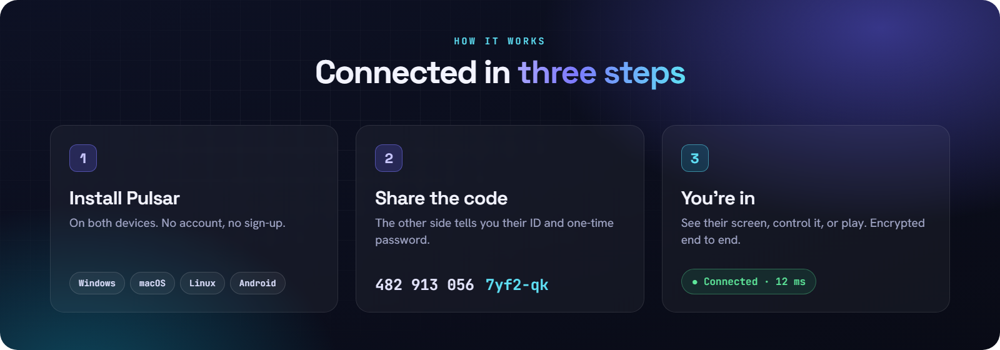

  

<h3 align="center">Free, open-source remote desktop and game streaming.</h3>

  Reach your own computer from anywhere, help a friend with theirs, or play your PC games on another screen. 
  An alternative to TeamViewer, AnyDesk, Parsec and RustDesk with <b>no account</b>, <b>no subscription</b> and <b>no tracking</b>.

  
  
  
  

  <a href="https://pulsardesk.com"><b>pulsardesk.com</b></a> ·
  <a href="https://github.com/PulsarDesk/pulsar-desktop"><b>Desktop app</b></a> ·
  <a href="https://github.com/PulsarDesk/pulsar-mobile"><b>Android app</b></a> ·
  <a href="https://github.com/PulsarDesk/relay"><b>Your own server</b></a>

 

<table>
<tr>
<td width="50%" valign="top">

### 🖥️ Remote desktop
Help family and friends, or reach your own PC from the office. Tabs like a browser, split screen, file transfer,
clipboard, chat and voice, all in one window.

</td>
<td width="50%" valign="top">

### 🎮 Game streaming
Play your gaming PC from the couch, a laptop or your phone. Up to 4K and 240 fps with HDR, and your controller
works like it's plugged in. A real DualSense, triggers and all.

</td>
</tr>
<tr>
<td width="50%" valign="top">

### 🔒 Private by design
Every session is end-to-end encrypted, always. Even the relay server only forwards data it can't read. No
telemetry, no ads.

</td>
<td width="50%" valign="top">

### ⚡ Just works
Share an ID and a one-time password and you're in. Pulsar connects directly when it can and through a relay when
it can't. No router settings, no sign-up.

</td>
</tr>
</table>

## 🌌 Projects

| | Project | What it is | Runs on |
|---|---|---|---|
| 🖥️ | [**Pulsar Desktop**](https://github.com/PulsarDesk/pulsar-desktop) | The app for computers | Windows, macOS, Linux (x64, arm64) |
| 📱 | [**Pulsar Mobile**](https://github.com/PulsarDesk/pulsar-mobile) | The app for phones, tablets and TVs | Android (iOS not yet) |
| 🛰️ | [**Pulsar Relay**](https://github.com/PulsarDesk/relay) | Your own Pulsar server, in one command | Docker, Linux, Windows, macOS |
| 🌐 | [**Website**](https://github.com/PulsarDesk/web) | [pulsardesk.com](https://pulsardesk.com) | — |

Under the hood: [pulsar-core](https://github.com/PulsarDesk/pulsar-core) (the engine both apps share),
[pulsar-proto](https://github.com/PulsarDesk/pulsar-proto) (the protocol) and
[design](https://github.com/PulsarDesk/design) (colors, fonts and screens).

## 💬 Get involved

Pulsar is in **alpha** and moving fast. Reports from real devices help the most:

- 🐞 **Found a bug?** Open an issue for the [desktop](https://github.com/PulsarDesk/pulsar-desktop/issues/new/choose)
  or [mobile](https://github.com/PulsarDesk/pulsar-mobile/issues/new/choose) app, with your system, graphics card
  and the app's log file.
- 🛠️ **Want to help?** Issues and pull requests are welcome in every repository.
- ⭐ **Like it?** A star helps other people find Pulsar.

  Every Pulsar project is free software under the GNU GPLv3 or later.

